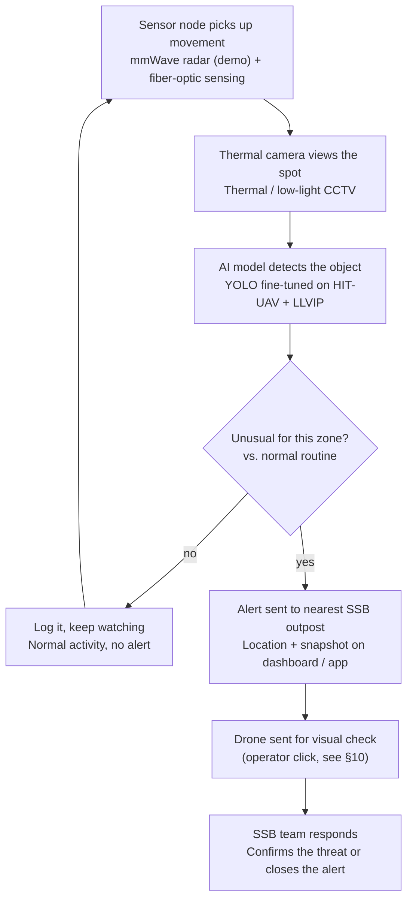

# TRINETRA – Product Requirements Document

**Date:** Oct 11, 2026 · **Author:** @Ananya Negi
**Source:** `TRINETRA prd (1).pdf` (Oct 11 revision). This file replaces the Oct 10 PRD.
Demo-build decisions taken after this PRD are in [section 10](#10-demo-build-decisions-oct-14-2026).

---

## 1. Overview

TRINETRA is an AI-powered, context-aware surveillance system that spots unusual activity on unfenced border stretches and alerts the nearest SSB outpost in real time.

- **Problem:** Long parts of the India–Nepal border are unfenced and hard to watch, especially at night, in fog or in thick terrain. Guards cannot watch every stretch all the time, so unusual activity is often noticed late.
- **Solution:** Place sensor nodes and thermal AI cameras along a zone. When the system sees something unusual for that zone, it alerts SSB with the location (the AI does not decide the situation; a human does) and sends a drone to check if needed.

## 2. Goals and non-goals

**Goals**
- Detect unusual movement in a border zone, day and night
- Reduce false alarms by checking every trigger with AI before alerting
- Alert the nearest SSB outpost in real time, with location
- Send a drone to the spot for quick visual confirmation

**Non-goals**
- Identifying a person's nationality or identity from appearance or body movement
- Covering the full 1,751-km border in the hackathon (the demo covers one zone)

## 3. Users

| User | What they need | What TRINETRA gives them |
| :--- | :--- | :--- |
| SSB outpost personnel | Know quickly when and where something is happening | Real-time alert with location and a camera snapshot |
| Control room operator | One view of every zone and alert | Live dashboard with alert status |

## 4. Core features

In deployment, radar nodes and fiber together cover the planned 200–500 m per node. The demo uses a low-cost mmWave module with a range of a few metres, enough to show the full flow.

| # | Feature | What it does | Priority |
| :--- | :--- | :--- | :--- |
| 1 | mmWave radar nodes | Detect movement, distance and speed in fog, rain, heat and darkness; used in the demo | Must |
| 2 | Fiber-optic sensing (DAS) | A buried fiber cable senses footsteps and digging along long open stretches | Should (deployment) |
| 3 | AI camera detection | Thermal / low-light CCTV with a YOLO model detects people and vehicles, even at night; fine-tuned to detect anomalies | Must |
| 4 | Anomaly check | Compares activity with the zone's normal routine and flags only what is unusual | Must |
| 5 | Alert dashboard and app | Sends real-time alerts to the nearest SSB outpost with location and video | Must |
| 6 | Drone trigger | Sends a drone to the spot for visual confirmation | Should |

## 5. System flow

Sensors wake the camera, the AI checks if the activity is unusual for that zone, and only real anomalies reach SSB and the drone. Normal activity is logged and the zone keeps being watched.

## 6. Tech stack and model plan

The pretrained YOLO model has already been tested on sample data; the next step is fine-tuning it on thermal images.

| Part | Choice |
| :--- | :--- |
| Object detection | YOLO, fine-tuned for thermal images |
| Training data | HIT-UAV + LLVIP thermal datasets combined |
| Training setup | Local, on an ASUS A15 laptop (RTX 3050) |
| Sensors | Demo: low-cost mmWave radar module · Deployment: mmWave radar + fiber-optic sensing (DAS) |
| Cameras | Thermal / low-light CCTV |
| Alerts | Web dashboard |

Open question in the PRD (framework for the dashboard and app) is resolved in §10: **React**.

## 7. Success metrics

Targets will be set after the first fine-tuning run gives a baseline.

| Metric | How we measure it | Where it shows in the build |
| :--- | :--- | :--- |
| Detection accuracy | mAP@0.5 of the fine-tuned model on a held-out thermal test set, compared with the pretrained model | Training report (not in the app yet) |
| False alarm rate | Share of alerts that turn out to be normal activity | Header "False alarms" · `GET /api/metrics` |
| Alert time | Seconds from sensor trigger to alert on the dashboard | Header "Alert time" · per-alert "Alert in N s" |
| Night performance | Detection accuracy on low-light / thermal frames | Training report |

## 8. Scope and rollout

The system is modular, so it grows one sensor node at a time instead of covering the whole border at once.

1. **Hackathon demo:** one representative zone with a mmWave radar sensor node, showing the full flow from detection to alert.
2. **Phase 1:** start where the problems are biggest, the highest-incident zones (where SSB reports the most illegal crossings or smuggling). Radar nodes go at specific spots like paths, crossings and villages near the border. Fiber cable goes along long, empty stretches like open fields or riverbanks, where one buried cable can cover kilometres. This phase proves the system in the real world, and the AI learns each zone's normal routine.
3. **Phase 2:** expand slowly. Add nodes to the next zones one at a time, gradually covering more of the 1,751-km border. Each new node plugs in without redesign.

## 9. Risks and design principles

**Design principles**
- **Detect anomalies, not people:** the system never guesses nationality or identity from appearance or body movement; it only flags activity that is unusual for that zone.
- **Modular:** each node works on its own, so more can be added as needed.

| Risk | How we handle it |
| :--- | :--- |
| Small training set (about 1,500 images) may limit accuracy | Combine both datasets, use augmentation, compare against the pretrained baseline |
| False alarms from animals or weather | Camera + AI check before any alert; compare with the zone's normal routine |
| Limited GPU (RTX 3050) slows training | Use a smaller YOLO variant and a lower image size |
| Demo radar module has a short range | Demo one spot; explain deployment-grade range in the pitch |
| Fiber-optic sensing is costly to lay | Use it only on long open stretches; radar nodes elsewhere |
| Power and network in remote areas | Open question for Phase 1 |

## 10. Demo-build decisions (Oct 14, 2026)

| Topic | Decision |
| :--- | :--- |
| Drone | **Operator click only.** Nothing in the pipeline launches the drone. The "geo-fence trigger" in the flow means the drone flies to the alert's location once the operator sends it. |
| Alert video | Each alert shows a **looping, prerecorded** thermal clip (not live). Until the clips are recorded the dashboard shows a placeholder in the same slot. Clips go in `data/media/clips/`. |
| Hardware | **No hardware in the demo.** A virtual mmWave node (scenario player, `sim/radar_node.py`, and a drive-a-target mode on the map) sends the same JSON a real node would. Every simulated input is labelled. |
| Dashboard | **React** (Vite + TypeScript + Leaflet), served by the FastAPI backend. |
| Animals | The HIT-UAV + LLVIP classes have no animal class, so an animal shows up as "no person or vehicle" and is logged, not alerted. |
| Fiber (DAS) | Drawn on the map for the deployment picture only; not simulated as an input. |

Full requirements and the build plan: [WEBSITE_FUNCTIONAL_REQUIREMENTS_AND_PLAN.md](WEBSITE_FUNCTIONAL_REQUIREMENTS_AND_PLAN.md).
