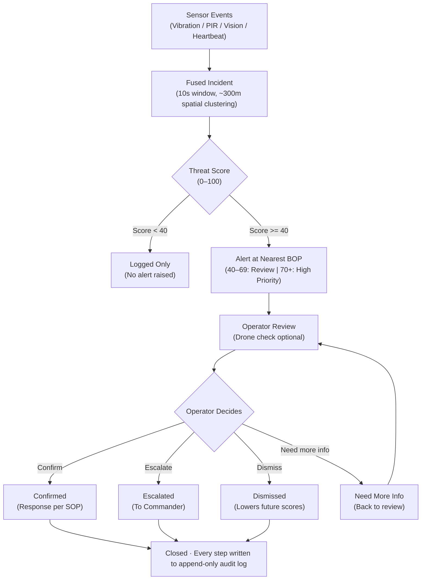

# TRINETRA — Product Requirements Document

**Date:** Oct 10, 2026 · **Author:** @Ananya Negi  
**Version:** v1.0 (Hackathon MVP) · **Status:** Draft  

---

## 1. Overview

**TRINETRA v1.0** is a hackathon prototype that monitors one fictional open-border zone, fuses ground, vision, and simulated aerial signals, and sends explained, prioritised alerts to the nearest Border Outpost (BOP) for a human to decide. It covers one zone, one BOP, one real sensor node, and two to four simulated nodes.

| Item | Value |
| :--- | :--- |
| **Product** | TRINETRA — context-aware border early-warning system |
| **Version in scope** | v1.0 (hackathon MVP) |
| **Status** | Draft |
| **Target event** | NIT Delhi hackathon (date to confirm) |
| **Build approach** | Hybrid: real node + real models + simulated zone with replay fallback |
| **Related** | TRINETRA — Project Blueprint (problem, solution, tech stack, demo script) |

### Core Value Proposition

- **One-line problem:** On an open border, movement is normal; thinly spread outposts need to know what is unusual, at night and in fog, without drowning in false alarms.
- **One-line product:** Sense the ground, see through thermal, confirm from the air, judge against what is normal for this zone and hour, and alert the nearest outpost only when several signals agree.

### Conventions in this PRD

- **P0:** Must ship for the demo.
- **P1:** Should ship.
- **P2:** Nice to have.
- Requirement IDs (`FR-x`, `NFR-x`) are referenced by the acceptance test suite (`AT-x`).

---

## 2. Goals, Non-Goals and Success Metrics

### Goals (v1.0)

1. **Show one complete detection-to-response flow:** Sensor trigger → fusion → explained score → alert at nearest BOP → drone check → human decision → incident log.
2. **Prove context beats raw detection:** Routine crossings and animals are ignored while a night intrusion is flagged.
3. **Cut false alarms versus single-sensor alerting:** Demonstrate and show the measured difference.
4. **Make every alert explainable:** Each score lists the factors that raised or lowered it.
5. **Keep humans in charge and individuals unprofiled:** No autonomous weapon/dispatch systems, zero facial/identity profiling.

### Non-Goals (Explicitly out of scope for v1.0)

- **Identifying who a person is:** No face recognition, no nationality, ethnicity, or religion inference.
- **Any autonomous action:** No automatic dispatch, no weapons, no barriers.
- **Real drone flight control:** No actual UAV hardware control; no real Sashastra Seema Bal (SSB) systems, data, or production integrations.
- **Coverage beyond one fictional zone:** No production-grade hardware, weatherproof enclosures, or field trials.
- **Claims of field accuracy:** Demo metrics reported strictly as measured on synthetic/test datasets.

### Success Metrics

*(Measured on the scenario test set, reported as measured)*

| Metric | Target for v1.0 | How Measured |
| :--- | :--- | :--- |
| **Scenario outcome correctness** | 4 of 4 demo scenarios give the expected result in 20 of 20 runs | Scripted run of each scenario 20 times |
| **False alarms, fused vs single sensor** | Fused alerts fewer than single-sensor alerts on the same set | Count both on the 4-scenario set + 50 random synthetic events |
| **Trigger-to-alert latency** | Under 3 s on local network | Timestamp at node publish vs alert shown on dashboard |
| **Explained alerts** | 100% of alerts list at least one reason | Automated check on the alert table |
| **YOLO detection quality** | Report mAP@0.5 on held-out thermal images (no fixed target) | Ultralytics validation run |
| **Vibration classifier** | Report accuracy + confusion matrix on own recordings (no fixed target) | 80/20 train/test split |
| **Demo reliability** | Replay fallback switches in under 5 s | Rehearsal with Wi-Fi turned off |

---

## 3. Users and Personas

Three operational roles and one demo role use v1.0 (illustrative personas):

| Persona | Role | Needs | Pain Today | Uses in TRINETRA |
| :--- | :--- | :--- | :--- | :--- |
| **Control-room operator** *(e.g. "Head Constable on night shift")* | Watches the zone from the BOP; first to act on an alert | Few, trustworthy alerts with the reason and a picture | Staring at feeds for hours; single sensors cry wolf | Dashboard, alert card, drone check, confirm/dismiss |
| **Field / QRT member** | Moves to the location when sent | Exact location, direction of movement, what to expect | Vague radio messages, no picture | Mobile (PWA) alert view |
| **Post / company commander** | Oversees several BOPs and zones | Patterns over time, who decided what, workload | No structured history per stretch | Heatmap, incident timeline, audit log, thresholds |
| **Demo admin** *(team member)* | Runs scenarios during the demo | One-click, repeatable scenarios and a safe fallback | — | Scenario panel, replay switch, reset |

---

## 4. User Stories

| ID | As a… | I want to… | So that… | Priority |
| :--- | :--- | :--- | :--- | :--- |
| **US-1** | Operator | see every node, the BOP and the crossing point on a live map | I know the state of my zone at a glance | **P0** |
| **US-2** | Operator | get an alert only when several signals agree something is unusual | I trust alerts and don't ignore them | **P0** |
| **US-3** | Operator | see why an alert was raised (reasons, score, snapshot, direction) | I can judge it in seconds | **P0** |
| **US-4** | Operator | confirm, dismiss, escalate or ask for more info, with a note | my decision is recorded | **P0** |
| **US-5** | Operator | send a drone to the alert location with one click | I can verify before sending people | **P1** |
| **US-6** | Operator | not be alerted for villagers at the market crossing in daytime or for animals | my attention goes where it matters | **P0** |
| **US-7** | Operator | be told when a node goes offline | blind spots don't go unnoticed | **P1** |
| **US-8** | QRT member | receive the alert on my phone with location and snapshot | I know where to go and what to expect | **P1** |
| **US-9** | Commander | see a heatmap and timeline of incidents per zone | I can spot repeated probing of a stretch | **P1** |
| **US-10** | Commander | see an audit trail of every alert and decision | the system is accountable | **P0** |
| **US-11** | Commander | adjust scoring weights and alert thresholds | the system fits each zone | **P1** |
| **US-12** | Operator | have dismissed false alarms lower the weight of similar future events | the system learns my zone | **P1** |
| **US-13** | Demo admin | run any scenario with one click and switch to replay if hardware fails | the demo never breaks | **P0** |

---

## 5. Functional Requirements

Each requirement has one testable acceptance criterion. P0 items together form the demo; nothing P1 starts until all P0 items pass.

### A. Sensing

| ID | Requirement | Acceptance Criterion | Priority |
| :--- | :--- | :--- | :--- |
| **FR-1** | The real ground node (ESP32 + vibration sensor + PIR) publishes events to MQTT in the shared event schema | Stamping near the node produces a `vibration` event and walking past produces a `pir` event on the broker within 1 s | **P0** |
| **FR-2** | The node sends a heartbeat every 10 s with battery and signal fields | Unplugging the node marks it offline on the dashboard within 30 s | **P1** |
| **FR-3** | The vibration classifier labels each 2 s window as footstep, vehicle, animal or noise with a confidence | Labels appear on events; accuracy and confusion matrix are reported from the test split | **P0** |
| **FR-4** | A vision event is produced when a ground trigger fires: YOLO runs on the camera / thermal clip linked to that node | Ground trigger → detection event with class, count, confidence and snapshot within 2 s | **P0** |
| **FR-5** | YOLO detects person, vehicle, two-wheeler, animal and boat classes | Class shown on the alert card matches the clip used in each scenario | **P0** |
| **FR-6** | The scenario engine publishes simulated events for virtual nodes with `source = sim` | Each of the 4 scenarios publishes the same event sequence every run | **P0** |

### B. Intelligence

| ID | Requirement | Acceptance Criterion | Priority |
| :--- | :--- | :--- | :--- |
| **FR-7** | Fusion groups events from the same zone within a 10 s window and ~300 m into one incident | Vibration + PIR + vision events from one scenario produce exactly one incident | **P0** |
| **FR-8** | An incident backed by one sensor type only is capped below the high-priority band | A lone vibration event never produces a high-priority alert | **P0** |
| **FR-9** | The context engine applies time-of-day baseline, known crossing routes, restricted geofences, group size and direction | Each factor appears as a reason when it applies | **P0** |
| **FR-10** | The rule engine outputs a 0–100 score, a band (log / review / high) and the list of contributing factors with their weights | Score equals the sum of listed factor weights, clamped to 0–100 | **P0** |
| **FR-11** | Scoring weights and band thresholds are configurable without code changes | Changing a weight in settings changes the next score | **P1** |
| **FR-12** | An Isolation Forest score is computed from the synthetic baseline and shown beside the rule score | Both scores appear on the alert card | **P2** |
| **FR-13** | Dismissed alerts reduce the weight of similar future events (same node, hour band, class) | Re-running a dismissed scenario yields a lower score | **P1** |
| **FR-14** | Loitering (>5 min in one geofence) and repeated probing (3+ incidents on one stretch in 7 days) are flagged | Simulated tracks trigger the factor | **P2** |

### C. Alerting and Response

| ID | Requirement | Acceptance Criterion | Priority |
| :--- | :--- | :--- | :--- |
| **FR-15** | Incidents scoring 40+ create an alert routed to the nearest BOP by distance | Alert shows the correct BOP and distance in km | **P0** |
| **FR-16** | Alerts are pushed live to the dashboard over WebSocket with a sound cue for high priority | Alert appears without page refresh | **P0** |
| **FR-17** | The alert card shows score, band, reasons, snapshot, location, direction, sensor timeline and data source labels | All fields present for the intrusion scenario | **P0** |
| **FR-18** | The operator can confirm, dismiss, escalate or mark need-more-info, with a mandatory note on dismiss and escalate | State changes and the note is stored | **P0** |
| **FR-19** | One-click drone dispatch animates a drone to the alert geofence and plays the recorded aerial clip, labelled simulated | Drone reaches the point and clip plays within 10 s | **P1** |
| **FR-20** | Alerts are delivered to a mobile PWA view for the BOP | Phone shows the alert within 3 s of the dashboard | **P1** |

### D. Records and Analytics

| ID | Requirement | Acceptance Criterion | Priority |
| :--- | :--- | :--- | :--- |
| **FR-21** | Every event, incident, alert and operator action is written to an append-only audit log with user and timestamp | Audit view lists the full history of the intrusion alert | **P0** |
| **FR-22** | Incident timeline per zone, filterable by date, band and outcome | Filters change the list correctly | **P1** |
| **FR-23** | Activity heatmap per zone over a selected time range | Heatmap reflects the synthetic 30-day history | **P1** |
| **FR-24** | Dashboard summary: events today, alerts by band, pending vs reviewed, node health | Counts match the database | **P1** |

### E. Demo, Access and Safeguards

| ID | Requirement | Acceptance Criterion | Priority |
| :--- | :--- | :--- | :--- |
| **FR-25** | Scenario panel runs: routine crossing, animal trigger, night intrusion, node offline | Each runs with one click and gives the expected outcome | **P0** |
| **FR-26** | A replay switch replaces live inputs with pre-recorded event streams, labelled replay | Switching mid-demo takes under 5 s and the flow continues | **P0** |
| **FR-27** | A persistent banner states which inputs are real, simulated or replayed | Banner visible on every screen | **P0** |
| **FR-28** | Reset clears demo incidents and restores the baseline | Reset returns counts to the starting state | **P0** |
| **FR-29** | Role-based login: operator, commander, admin | Operator cannot change weights; commander can | **P2** |
| **FR-30** | Snapshots are stored only for alerts and auto-deleted after a configurable retention period | Non-alert events hold no image; retention setting works | **P1** |
| **FR-31** | No face recognition or identity attributes anywhere in the pipeline | Code review: no such models or fields exist | **P0** |
| **FR-32** | Alert summary available in Hindi | Toggle shows Hindi reasons text | **P2** |

---

## 6. Alert Lifecycle

> **Core Principle:** No alert closes without an operator decision.



### Lifecycle Rules

- **Under 40 (`LOG`):** Incidents under 40 are only logged into the database; no notification or alert is raised.
- **40–69 (`REVIEW`):** Become triage review alerts for operator assessment.
- **70+ (`HIGH`):** High-priority alerts triggers audible sound cue, auto-pins to the top of the queue.
- **Closure:** An alert stays open until the operator confirms, escalates, or dismisses it. Mandatory notes are required for dismissal and escalation.
- **Feedback Loop:** "Need more info" returns the alert to review. Dismissals feed back into the context scoring system to lower the weight of future similar occurrences.

---

## 7. Screens and UI Requirements

The UI is a dark command-centre web app (**React + Leaflet**) plus a mobile phone view (**PWA**). Six screens cover v1.0:

| Screen | Main Contents | Key Interactions | Requirements | Priority |
| :--- | :--- | :--- | :--- | :--- |
| **1. Live zone map (home)** | Map of Zone 1: nodes (green/amber/red/grey for health), BOP, market crossing, restricted geofences, live alert pins; right-side alert queue sorted by score; simulation banner | Click node → recent events; click alert → alert card | FR-15, FR-16, FR-24, FR-27 | **P0** |
| **2. Alert card (side panel)** | Score + band, reasons with weights, snapshot, class + count, direction arrow, sensor timeline (last 60 s), BOP + distance, source labels | Confirm / dismiss / escalate / need info + note; Send drone | FR-17, FR-18, FR-19 | **P0** |
| **3. Drone check** | Drone icon flying to geofence on the map; recorded aerial thermal clip; "SIMULATED" tag | Close, return to alert | FR-19 | **P1** |
| **4. Incidents & audit** | Timeline list with filters; heatmap toggle; full audit trail per alert | Filter, open incident, export CSV | FR-21, FR-22, FR-23 | **P0** (audit)<br>**P1** (rest) |
| **5. Settings** | Scoring weights, band thresholds, fusion window, retention period | Edit and save; reset to defaults | FR-11, FR-30 | **P1** |
| **6. Scenario panel (admin)** | Four scenario buttons, live/replay switch, reset | One-click run, toggle, reset | FR-25, FR-26, FR-28 | **P0** |
| **Phone view (PWA)** | Alert list; alert detail with snapshot, map pin, reasons | Acknowledge; open in maps | FR-20 | **P1** |

### UI Design Rules

- **Colour Meaning:** Colour carries one meaning only:
  - Threat Bands: `grey` (Log), `amber` (Review), `red` (High).
  - Node Health: `green` (online), `amber` (warning), `red` (error), `grey` (offline).
  - *Never color people or demographic groups.*
- **No Bare Numbers:** Every number on an alert has its explanation next to it (e.g., no bare "87% threat").
- **Clear Provenance:** Simulated, replayed, and real data streams are always labelled (`real`, `sim`, `replay`).
- **Alert Pinning & Sound:** High-priority alerts play an audible cue and pin to the top of the queue until acted upon.
- **Responsive Layout:** Must work cleanly on a standard 1366×768 laptop screen and a phone in portrait mode.

---

## 8. Data Model, MQTT Topics and API

One event schema serves real, simulated, and replayed inputs; the `source` field is the only difference.

### Core Tables (PostgreSQL + PostGIS)

| Table | Key Fields |
| :--- | :--- |
| `zones` | `id`, `name`, `polygon` (geometry), `baseline_profile` (JSON of expected activity by hour) |
| `nodes` | `id`, `zone_id`, `type` (`real`/`sim`), `location` (point), `status`, `battery`, `last_heartbeat` |
| `bops` | `id`, `name`, `location` (point), `contact` |
| `geofences` | `id`, `zone_id`, `kind` (`crossing_route` / `restricted` / `riverbed` / `forest_track`), `polygon` |
| `events` | `id`, `node_id`, `zone_id`, `type` (`vibration`/`pir`/`vision`/`heartbeat`), `label`, `confidence`, `count`, `direction`, `ts`, `location`, `source`, `snapshot_url` |
| `incidents` | `id`, `zone_id`, `event_ids[]`, `start_ts`, `end_ts`, `sensor_types[]`, `rule_score`, `ml_score`, `band`, `reasons` (JSON) |
| `alerts` | `id`, `incident_id`, `bop_id`, `distance_km`, `status`, `created_ts`, `acted_ts` |
| `actions` | `id`, `alert_id`, `user_id`, `action` (`confirm`/`dismiss`/`escalate`/`need_info`/`drone`), `note`, `ts` |
| `audit_log` | `id`, `entity`, `entity_id`, `actor`, `change` (JSON), `ts` — *append-only* |
| `settings` | `weights` (JSON), `thresholds`, `fusion_window_s`, `retention_days` |

### MQTT Topics

```text
trinetra/{zone}/{node}/vibration  # classified 2 s window
trinetra/{zone}/{node}/pir        # motion on/off
trinetra/{zone}/{node}/vision     # YOLO result + snapshot ref
trinetra/{zone}/{node}/heartbeat  # every 10 s
trinetra/control/scenario         # scenario start / replay switch
```

### Event Payload Schema

```json
{
  "event_id": "e-1042",
  "node_id": "Z1-N2",
  "zone_id": "Z1",
  "type": "vibration",
  "label": "footstep",
  "confidence": 0.87,
  "ts": "2026-10-12T02:40:11+05:30",
  "lat": 26.85,
  "lon": 84.23,
  "source": "real"
}
```

### REST + WebSocket API (FastAPI)

| Method | Endpoint | Purpose |
| :--- | :--- | :--- |
| `GET` | `/zones/{id}` | Zone, nodes, BOPs, geofences for the map |
| `GET` | `/alerts?status=&band=` | Alert queue |
| `GET` | `/alerts/{id}` | Full alert card: incident, events, reasons, snapshot |
| `POST` | `/alerts/{id}/actions` | Confirm / dismiss / escalate / need_info with note |
| `POST` | `/alerts/{id}/drone` | Start simulated drone check |
| `GET` | `/incidents?zone=&from=&to=` | Timeline and heatmap data |
| `GET` | `/audit?entity=&id=` | Audit trail |
| `GET` / `PUT` | `/settings` | Weights, thresholds, retention |
| `POST` | `/scenarios/{name}/run` | Run a demo scenario |
| `POST` | `/scenarios/mode` | Switch live / replay |
| `POST` | `/demo/reset` | Reset demo state |
| `WS` | `/ws/alerts` | Live alerts and node status |

---

## 9. Non-Functional Requirements (NFRs)

| ID | Area | Requirement | Priority |
| :--- | :--- | :--- | :--- |
| **NFR-1** | Latency | Trigger-to-dashboard alert under 3 s on local network; phone under 3 s after dashboard | **P0** |
| **NFR-2** | Reliability | Each demo scenario gives the expected outcome 20 of 20 runs; replay fallback in under 5 s | **P0** |
| **NFR-3** | Portability | Whole stack starts with one `docker compose up` on a team laptop, no internet needed after setup (cached map tiles) | **P0** |
| **NFR-4** | Explainability | Every alert lists its contributing factors; score = sum of listed weights | **P0** |
| **NFR-5** | Privacy | No face recognition, no identity or nationality attributes; snapshots only for alerts; retention limit | **P0** |
| **NFR-6** | Human control | No action leaves the system without an operator click | **P0** |
| **NFR-7** | Security | TLS on MQTT and API where feasible; JWT auth; append-only audit log | **P1** |
| **NFR-8** | Honesty | Real / sim / replay labels on all data; only measured metrics in UI and slides | **P0** |
| **NFR-9** | Edge readiness | Node firmware uses deep sleep between triggers; camera inference only on trigger | **P1** |
| **NFR-10** | Low bandwidth | Node payloads under 256 bytes; snapshots compressed to under 100 KB | **P1** |
| **NFR-11** | Usability | An unfamiliar user can open and act on an alert in under 30 s | **P1** |
| **NFR-12** | Responsiveness | Dashboard usable at 1366×768; PWA usable on a phone in portrait | **P1** |

---

## 10. Release Plan and Acceptance Tests

Ship in three milestones; each has an exit gate that must pass before the next starts. Dates are fixed once the hackathon date is confirmed.

1. **M1 — Thin slice (P0 software):** Simulated events flow end to end: scenario engine → MQTT → fusion → score → alert card → action → audit.  
   *Gate:* AT-1 to AT-4 pass on simulated data.
2. **M2 — Real parts (P0 hardware + models):** Real node, trained vibration classifier, thermal-tuned YOLO plugged into the same flow; replay recordings made.  
   *Gate:* AT-1 to AT-7 pass with the real node.
3. **M3 — Demo-ready (P1 items + polish):** Drone check, PWA, heatmap, settings, feedback loop, metrics slide.  
   *Gate:* All acceptance tests pass; full 4-minute rehearsal three times in a row without a failure.

### Acceptance Tests

| ID | Scenario | Steps | Expected Result | Covers |
| :--- | :--- | :--- | :--- | :--- |
| **AT-1** | Routine crossing | Run "market crossing, 10 AM" | Events logged; score in log band; no alert | FR-6, FR-9, FR-10 |
| **AT-2** | Animal trigger | Run "animal" (or tap node + cow clip) | Vision says animal; score below 40; no alert | FR-3, FR-4, FR-8 |
| **AT-3** | Night intrusion | Run "2:40 AM forest track" | One incident; high band; reasons include night, off-route, sensors agree; alert at nearest BOP | FR-7, FR-9, FR-10, FR-15, FR-17 |
| **AT-4** | Operator decision | Confirm AT-3 alert with a note | Status confirmed; audit shows the full chain | FR-18, FR-21 |
| **AT-5** | Single sensor cap | Publish one vibration event only | Never reaches high band | FR-8 |
| **AT-6** | Node offline | Unplug real node | Node turns grey; offline alert within 30 s | FR-2 |
| **AT-7** | Replay fallback | Turn Wi-Fi off mid-AT-3, switch to replay | Flow continues; banner shows replay | FR-26, FR-27 |
| **AT-8** | Drone check | Click Send drone on AT-3 | Drone reaches geofence; clip plays; labelled simulated | FR-19 |
| **AT-9** | Phone alert | Run AT-3 with phone open | Alert on phone within 3 s | FR-20, NFR-1 |
| **AT-10** | Feedback | Dismiss a review-band alert, re-run the same scenario | Lower score on re-run | FR-13 |
| **AT-11** | Reset | Click reset | Counts return to starting state | FR-28 |

---

## 11. Assumptions, Dependencies, Risks and Open Questions

### Assumptions

- Team of four (hardware, ML, backend, frontend + pitch).
- One team laptop runs the full stack.
- Demo venue has power for the node and a laptop.
- Judges accept public datasets and a fictional zone when clearly labelled.

### Dependencies

- **Hardware:** ESP32, ADXL345 or piezo disc (not SW-420), HC-SR501 PIR, USB power bank; optional SX1276 LoRa pair.
- **Data:** Teledyne FLIR ADAS, KAIST / LLVIP, HIT-UAV (licences to check); the team's own vibration recordings.
- **Software:** Ultralytics YOLO, scikit-learn, librosa, FastAPI, Mosquitto, PostgreSQL + PostGIS, React, Leaflet, Docker.

### Risks and Mitigations

| Risk | Impact | Mitigation |
| :--- | :--- | :--- |
| **Real node or Wi-Fi fails during demo** | Demo breaks | Replay mode (FR-26), rehearsed switch |
| **Vibration classifier weak on few samples** | Wrong labels | Record more samples; fall back to RMS threshold + fusion cap |
| **YOLO weak on thermal** | Missed detections | Fine-tune on FLIR; pick demo clips from the test set it handles |
| **Scope creep into P2 items** | P0 unfinished | Gate rule: no P1 work until all P0 tests pass |
| **Seen as profiling** | Ethics questions | FR-31, NFR-5, explicit safeguards slide |
| **Over-claiming** | Credibility loss | NFR-8: only measured numbers |

### Open Questions

- [ ] Hackathon date and duration — sets milestone dates.
- [ ] Final team size and who owns which area.
- [ ] Is a thermal camera available, or do we use a webcam + public thermal clips?
- [ ] LoRa modules available, or Wi-Fi only?
- [ ] Does the venue allow a physical device on the judging table?
- [ ] Fictional zone name and map location to use.
