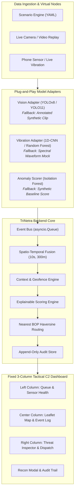

# TRINETRA Sentinel C2 — Website Functional Requirements & Plug-and-Play Implementation Plan

## 1. System Architecture & Layout Philosophy

### Preserving the Dashboard Layout
The current **3-Column Tactical Command & Control (C2)** workspace layout inspired by defense intelligence interfaces remains strictly intact:
- **Top Header:** Global telemetry, sector metadata, IST digital clock, live WebSocket connection state, audit log trigger, and operator shift indicator.
- **Left Column:** Threat Alert Queue (with severity tab filters) and Sensor Node Health Table (battery, signal dBm, last ping).
- **Center Column:** Tactical Leaflet Map (Map HUD bar with Satellite/Vector switcher, dynamic coordinates/MGRS, Tactical North, interactive geofences, node pulses, BOP rings, dynamic High-Alert banner) and bottom streaming Sensor Log.
- **Right Column:** Full-height Threat & Tactical C2 Inspector (Target/seen/heading/node/distance/ETA grid, thermal/optical camera feed with detection overlays, Explainable AI itemized score breakdown, operator triage buttons, and primary UAV/QRT dispatch button).
- **Footer Drawer:** Collapsible Scenario Simulation & Demo Control Bar.
- **Overlays & Modals:** Full-resolution surveillance camera viewer modal and append-only audit trail modal.

While the layout structure remains fixed, **the interactive elements within every panel will be fully functionalized**, eliminating hardcoded dummy values and replacing static stubs with live WebSocket synchronization, responsive state handlers, and automated fallbacks.



---

## 2. Functional Requirements for the Website

### A. Global Header & Tactical Navigation
| ID | Requirement | Acceptance Criteria |
| :--- | :--- | :--- |
| **FR-W1** | **Dynamic Link Status & Sync Indicator** | The link status badge in the header must reflect actual WebSocket connection state (`Online · synced <Xs ago>`, `Reconnecting...`, `Offline`). Reconnection must attempt exponentially every 2–5 seconds upon network interruption. |
| **FR-W2** | **IST Master Telemetry Clock** | The header clock (`#clock-ist`) must tick continuously at 1 Hz in Indian Standard Time (`HH:MM:SS IST`). |
| **FR-W3** | **Audit Trail Modal Launcher** | Clicking `#btn-audit-trail` must fetch `/api/audit` and populate the modal with a chronological, searchable table of timestamped operator actions, automated engine alerts, and sensor events. Pressing `Escape` or clicking the close button dismisses it. |
| **FR-W4** | **Operator Shift Identity** | Operator badge displays active session credentials (`Op. R. Sharma · Shift B`), which auto-attaches to all logged triage actions. |

---

### B. Left Column: Threat Queue & Sensor Health Table
| ID | Requirement | Acceptance Criteria |
| :--- | :--- | :--- |
| **FR-W5** | **Dynamic Alert Queue Rendering** | Alerts received via WebSocket or initial payload render as reactive queue cards displaying ID, score badge, target class, primary node, creation elapsed time, BOP ETA, and status indicator (`Pending`, `Tracked`, `Dispatched`, `Dismissed`). |
| **FR-W6** | **Severity Band Filtering** | Clicking filter tabs (`All`, `High (70+)`, `Review (40–69)`, `Log (<40)`) filters the queue in real-time without page reload, updating the active count badge. |
| **FR-W7** | **Queue Selection Synchronization** | Clicking any card in the queue marks it with `.selected`, updates the Right Column C2 panel with that alert's parameters, and smoothly pans the Leaflet map (`panTo`) to the alert's coordinates. |
| **FR-W8** | **Live Sensor Health Monitoring** | Sensor health table dynamically syncs with node states (`N1` to `N4`). When heartbeat events arrive, update battery percentage and signal dBm. If a node heartbeats times out or goes offline, display a high-visibility amber/red `OFFLINE` badge and pulse warning on the map. |

---

### C. Center Column: Tactical Leaflet Map & Live Sensor Log
| ID | Requirement | Acceptance Criteria |
| :--- | :--- | :--- |
| **FR-W9** | **Dual Vector & Satellite Layer Switcher** | Toggling the Map HUD pills (`Map` / `Satellite`) or pressing hotkeys `[M]` / `[S]` switches base layers seamlessly between CartoDB Dark Matter and Esri High-Resolution World Imagery without losing overlays. |
| **FR-W10** | **Real-Time Cursor Readout** | Mouse movements over the map update `#map-cursor-coords` with 4-decimal latitude/longitude and simulated MGRS tactical grid coordinates. |
| **FR-W11** | **Geofence & Sector Overlays** | Automatically render the Kali-Gandak international border line, BOP concentric security rings, and colored tactical geofences (Green: Market Crossing Corridor, Red: Restricted Zero-Line Riverbed, Yellow: Forest Track) with tooltips showing active operating hours and risk modifiers. |
| **FR-W12** | **Dynamic Threat Markers & Pulse Rings** | Active alerts place a pulsing tactical marker on the map color-coded by severity band (Red: High, Amber: Review). Clicking an alert pin on the map selects that alert in the queue and threat inspector. |
| **FR-W13** | **Interactive High-Alert Banner** | When an unacknowledged High Alert (score $\ge 70$) is active, `#map-alert-banner` pulses red in the Map HUD showing the alert ID and score. Clicking the banner centers the camera onto the threat. When all high alerts are resolved, the banner transitions to a neutral idle state. |
| **FR-W14** | **Streaming Sensor Event Log** | The bottom sensor log panel streams raw events (vibration, PIR, vision detections, heartbeat losses) chronologically with color tags (`warning`, `info`, `high`, `operator`, `drone`). New items prepend/append smoothly with autoscroll. |

---

### D. Right Column: Threat Inspector & Explainable AI (XAI)
| ID | Requirement | Acceptance Criteria |
| :--- | :--- | :--- |
| **FR-W15** | **Tactical Metadata Readout Grid** | Displays exact target classification (`Person ×3`, `Motorcycle ×1`, `Livestock`), elapsed time, heading degrees with cardinal vector (`045° · NE`), reporting node/cam, straight-line distance to nearest BOP in km, and computed QRT intercept ETA in minutes. |
| **FR-W16** | **Camera Telemetry Viewport & Modal** | Embedded viewport displays the optical/thermal surveillance snapshot with active camera name (`CAM 07 · Thermal`), live status pill, and timestamp. Clicking the viewport or `#btn-open-cameras` opens the expanded full-screen inspection modal with crosshair telemetry overlay and bounding box annotations. |
| **FR-W17** | **Explainable AI (XAI) Factor Breakdown** | Renders an itemized list of rule and context factors contributing to the threat score (e.g., `Night-time sector +30`, `Off authorised crossing route +25`, `Group of 3 or more +7`, `Wildlife suppression -40`). Every score change displays positive (+) and negative (-) weights that sum to the total score. |
| **FR-W18** | **Multi-Modal Confidence Indicator** | Displays individual model/sensor confidence percentages (e.g., `Thermal Vision 94% · PIR Motion 88% · Seismic Footfall 81%`), computed dynamically from the fused events. |
| **FR-W19** | **Real-Time Seismic Waveform Canvas** | Embed an animated HTML5 2D canvas visualizer simulating or displaying real-time geophone vibration frequencies (harmonic footfall spikes vs ambient noise vs vehicle thrum). |

---

### E. Operator Decision & Response Lifecycle
| ID | Requirement | Acceptance Criteria |
| :--- | :--- | :--- |
| **FR-W20** | **Operator Triage Actions (Triage Card Group)** | Provide accessible operator action triggers: **Confirm**, **Dismiss** (with mandatory justification note modal/prompt), **Escalate**, and **Track / Need Info**. |
| **FR-W21** | **Feedback Loop on Dismissal** | Dismissing an alert posts to `/api/alerts/{id}/actions` with action `dismiss` and note. The backend engine updates baseline suppression for similar events (same node, hour band, class), immediately reflected in the audit log. |
| **FR-W22** | **High-Priority Audio Cue** | When a score $\ge 70$ alert arrives over WebSocket, trigger an audible tactical warning beep (Web Audio API synth oscillator, respecting browser autoplay policies via initial user click enablement). |
| **FR-W23** | **One-Click Primary UAV & QRT Dispatch** | Clicking `#btn-action-dispatch` triggers `/api/alerts/{id}/drone`. The button updates to `DISPATCHED ✓`, and launches the autonomous drone reconnaissance animation. |

---

### F. Autonomous Drone Reconnaissance Simulation
| ID | Requirement | Acceptance Criteria |
| :--- | :--- | :--- |
| **FR-W24** | **Map Flight Trajectory Animation** | Disagreeing or dispatched alerts initiate an animated UAV icon flying from BOP-1 to the target alert coordinates over a 6-second trajectory on the Leaflet map. |
| **FR-W25** | **Aerial FLIR Reconnaissance Feed Modal** | Upon arrival, open an aerial recon HUD modal playing the simulated thermal UAV video/feed (`drone_recon.jpg` / video clip) with `SIMULATED DRONE RECON` watermark and live telemetry coordinates. |

---

### G. Demo Scenario Orchestration (Footer Bar)
| ID | Requirement | Acceptance Criteria |
| :--- | :--- | :--- |
| **FR-W26** | **Full Scenario Matrix Triggers** | Populate the footer drawer with one-click buttons for all five scenarios: **🚨 Night Intrusion**, **🚶 Market Crossing**, **🐄 Stray Animal**, **⚠️ Single Sensor**, and **📡 Node Offline**. |
| **FR-W27** | **Simulation Playback Speed Multiplier** | Speed selector dropdown (`1x`, `2x`, `4x`) passes the speed multiplier to `/api/scenarios/{name}/run`, speeding up timed event emission accordingly. |
| **FR-W28** | **One-Click Baseline Sandbox Reset** | Clicking `#btn-reset-sandbox` triggers `/api/demo/reset`, clearing active incidents, resetting node health to baseline, and restoring reference state across all connected clients via WebSocket broadcast. |

---

## 3. Plug-and-Play Model Architecture & Interface Contracts

To allow your trained ML models to plug directly into TRINETRA without modifying website templates, styling, or API plumbing, the backend features a **Model Provider Abstraction Layer**:

```
app/
├── ml/
│   ├── base.py                   # Abstract Base Classes for all models
│   ├── vision_adapter.py         # YOLOv8 / YOLO11 adapter (loads weights or falls back)
│   ├── vibration_adapter.py      # Seismic classifier adapter (loads weights or falls back)
│   ├── anomaly_adapter.py        # Isolation Forest baseline scorer (loads weights or falls back)
│   └── weights/                  # DROP-IN DIRECTORY for trained models
│       ├── vision_thermal.pt     # Place your trained YOLO weights here
│       ├── vibration_clf.joblib  # Place your trained vibration model here
│       └── baseline_iso.joblib   # Place your trained Isolation Forest model here
```

### 1. Vision Model Contract (`VisionModelAdapter`)
- **Trained Model Target:** Ultralytics YOLOv8 / YOLO11 (e.g., `best.pt` trained on thermal / night optical datasets: FLIR ADAS, LLVIP, HIT-UAV).
- **Interface Contract:**
```python
class VisionDetectionResult(BaseModel):
    detected_class: str          # "person", "motorcycle", "vehicle", "animal", "boat"
    count: int                   # number of instances detected
    confidence: float            # 0.0 to 1.0
    bounding_boxes: List[List[float]] # [[x1, y1, x2, y2], ...] normalized
    heading_deg: Optional[float] # estimated heading if tracking enabled
    snapshot_path: str           # path to rendered frame with bounding boxes

class BaseVisionModel(ABC):
    @abstractmethod
    def predict(self, frame_or_path: Union[str, np.ndarray]) -> VisionDetectionResult:
        pass
```
- **Fallback Behavior:** If `models/weights/vision_thermal.pt` is not present, the adapter automatically loads pre-extracted scenario detections and thermal snapshots (`static/assets/thermal_intrusion_group.jpg`, etc.) with zero runtime exceptions. When the `.pt` file is dropped into `weights/`, it automatically switches to live Ultralytics inference.

### 2. Vibration/Seismic Classifier Contract (`VibrationClassifierAdapter`)
- **Trained Model Target:** 1D-CNN or Scikit-Learn (Random Forest / Gradient Boosted Trees) trained on 2-second vibration windows (features: FFT peaks, RMS energy, zero-crossing rate, spectral centroid).
- **Interface Contract:**
```python
class VibrationClassificationResult(BaseModel):
    label: str                  # "footstep", "vehicle", "animal", "noise"
    confidence: float           # 0.0 to 1.0
    spectral_energy: float      # normalized energy value for waveform visualizer
    waveform_samples: List[float] # 100-point normalized frequency/time series for UI canvas

class BaseVibrationClassifier(ABC):
    @abstractmethod
    def classify(self, window_data: Union[List[float], np.ndarray]) -> VibrationClassificationResult:
        pass
```
- **Fallback Behavior:** If `vibration_clf.joblib` is not present, deterministic synthetic waveforms and features mapped to the scenario events are emitted. When the `.joblib` model is added, live window classification runs instantly.

### 3. Context Anomaly Scorer Contract (`AnomalyScorerAdapter`)
- **Trained Model Target:** Scikit-Learn `IsolationForest` or Elliptic Envelope trained on 30-day baseline hourly event frequencies.
- **Interface Contract:**
```python
class AnomalyScoreResult(BaseModel):
    anomaly_score: int          # 0 to 100
    is_outlier: bool
    cluster_distance: float

class BaseAnomalyScorer(ABC):
    @abstractmethod
    def score_incident(self, hour: int, zone_id: str, sensor_count: int, duration_s: float) -> AnomalyScoreResult:
        pass
```
- **Fallback Behavior:** Emits rule-correlated anomaly scores until the trained joblib model is supplied.

---

## 4. Step-by-Step Implementation Plan

### Phase 1: Model Abstraction Layer & Drop-in Weight Registry
- Create `app/ml/` directory structure with `base.py`, `vision_adapter.py`, `vibration_adapter.py`, `anomaly_adapter.py`, and `weights/`.
- Implement auto-discovery in adapters:
  - Check if `weights/vision_thermal.pt` exists $\to$ load Ultralytics `YOLO(weights)`; otherwise activate synthetic vision provider.
  - Check if `weights/vibration_clf.joblib` exists $\to$ load `joblib.load()`; otherwise activate synthetic waveform provider.
  - Check if `weights/baseline_iso.joblib` exists $\to$ load anomaly scorer; otherwise use heuristic fallback.
- Add diagnostic endpoint `GET /api/models/status`.

### Phase 2: Backend Event Pipeline & Data Schema Polish
- Extend `app/schema.py`:
  - Add `waveform_samples: Optional[List[float]]` and `confidence_breakdown: Optional[Dict[str, float]]` to `Alert` and `Event`.
  - Add full action set (`confirm`, `dismiss`, `escalate`, `need_info`, `drone_check`) to `OperatorAction`.
- Connect `app/engine/fusion.py` and `app/engine/scoring.py` to call the ML adapters cleanly during event processing.
- Update `app/main.py`:
  - Add full scenario runner endpoints for all 5 scenarios.
  - Implement audio cue signal in WebSocket alert broadcasts.
  - Implement dismissal feedback weight modification in `scoring.py`.

### Phase 3: Dashboard Center Column & Leaflet Map Enhancements
*(Preserving existing layout while making all elements live and interactive)*
- Connect `#btn-map-view` and `#btn-satellite-view` buttons to persist and toggle Leaflet base layers with smooth tile crossfade.
- Link mouse movement over Leaflet map to `#map-cursor-coords` updating decimal degrees and MGRS coords in real-time.
- Wire the `#map-alert-banner` to display the active highest-priority alert dynamically or fade out to idle.
- Animate tactical UAV marker flight across the map from BOP coordinates to alert coordinates upon drone dispatch.
- Enhance bottom `#sensor-log-box` with autoscroll, filtering, and timestamp format matching the IST master clock.

### Phase 4: Left & Right Column Interactive C2 Elements
*(Preserving existing layout while functionalizing all controls)*
- **Left Column (Alert Queue & Health Table):**
  - Wire queue filtering tabs (`All`, `High`, `Review`, `Log`) to state filtering.
  - Sync Sensor Health Table rows dynamically via WebSocket node updates (battery, dBm, `OFFLINE` alerts).
- **Right Column (Threat Inspector & Waveform):**
  - Inject HTML5 animated canvas into the Threat Inspector to render live seismic frequency waveforms.
  - Render itemized XAI factor rows with positive/negative pill formatting.
  - Dynamic multi-modal confidence line (`Thermal 94% · PIR 88% · Seismic 81%`).
  - Wire operator decision buttons (**Pending**, **Tracked**, **Confirm**, **Dismiss** with reason modal, **Escalate**).
  - Hook `#btn-action-dispatch` to trigger UAV recon flight and aerial modal popup.
- **Modals & Overlays:**
  - Enhance `#modal-cam-view` with bounding box visualizer and thermal telemetry OSD.
  - Enhance `#modal-audit-trail` with searchable, filterable logs and CSV export.

### Phase 5: Complete Scenario Matrix & Footer Demo Drawer
- Update footer HTML drawer with all 5 scenario buttons:
  - 🚨 Night Intrusion (`intrusion.yaml`)
  - 🚶 Market Crossing (`routine.yaml`)
  - 🐄 Stray Animal (`animal.yaml`)
  - ⚠️ Single Sensor (`single_sensor.yaml`)
  - 📡 Node Offline (`offline.yaml`)
- Link `#sel-scenario-speed` to scenario player execution interval.
- Verify that each scenario runs deterministically and reproduces the exact expected score and alert band.

### Phase 6: Model Drop-in Validation & End-to-End Verification
- Verify the entire system functions smoothly with zero missing dependencies in fallback mode.
- Test dropping sample YOLO weights into `app/ml/weights/vision_thermal.pt` to verify hot-swapping to live model inference without UI disruption.
- Validate browser compatibility, audio cue behavior, and layout stability at standard 1366×768 resolution.
