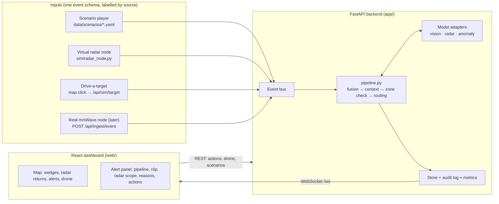

# TRINETRA — Functional Requirements & Build Plan (v2)

Aligned with the Oct 11 PRD ([PRD.md](PRD.md)) and the Oct 14 demo decisions (PRD §10):
radar-triggered, camera-confirmed, zone-aware alerting; operator-clicked drone; prerecorded looping clips;
no hardware (simulated radar node); React dashboard.

Status key: ✅ built · 🎞 built, waiting for media · 🔜 next · 🚫 out of scope for the demo

---

## 1. Architecture



### Event contract (all inputs)

```json
{ "event_id": "EV-1A2B3C", "node_id": "N3", "zone_id": "G2", "type": "radar",
  "ts": "2026-10-12T02:40:00+05:30", "source": "sim",
  "range_m": 180, "speed_mps": -1.3, "bearing_deg": 41, "track_id": "T1", "confidence": 0.9 }
```

| `type` | Extra fields | Notes |
| :--- | :--- | :--- |
| `radar` | `range_m`, `speed_mps` (negative = approaching), `bearing_deg`, `track_id` | Position is derived from the node + range + bearing if `lat`/`lon` are missing |
| `vision` | `label`, `count`, `confidence`, `heading_deg`, `snapshot`, `clip`, `bounding_boxes` | `label: "none"` = camera looked, saw no person or vehicle |
| `heartbeat` | `battery`, `signal_dbm` | Every 10 s; silent for 30 s → node offline |
| `heartbeat_timeout` | — | Forces a node offline (used by the Node Offline scenario) |
| `das` | `label` | Reserved for fiber sensing; not scored in the demo |

`source` is `sim`, `replay` or `live`. A real node only needs to POST this JSON.

---

## 2. Pipeline and scoring (PRD §5)

`app/engine/pipeline.py` runs every event through the PRD flow:

1. **Radar trigger.** Opens or extends an incident (same zone, 10 s window by arrival time, ~400 m). Camera goes `standby → waking`.
2. **Camera wake.** The next `vision` event from that node sets the camera to `recording`.
3. **YOLO detect.** A target is confirmed only for classes the HIT-UAV + LLVIP model can output: person, car, bicycle, motorcycle, other vehicle, truck, boat.
4. **Unusual for this zone?** Zone check against the zone's baseline routine (`baseline_profile` in `data/zone.json`).
5. **Outcome.** Score ≥ 40 → alert to the nearest SSB outpost (BOP). Otherwise logged, zone keeps watching.

### Zone-check factors (score = sum of listed factors, clamped 0–100)

| Factor | Weight | When |
| :--- | ---: | :--- |
| Night-time, low-traffic sector | +30 | 20:00–05:00 and baseline activity ≤ 0.1 at that place |
| Off authorised crossing route | +25 | Not inside the market-crossing geofence |
| Inside restricted zero-line geofence | +15 | Riverbed zone |
| Authorised crossing during market hours | −30 | Crossing geofence, 08:00–18:00 |
| Thermal camera confirms person/vehicle | +20 | YOLO target class |
| Group of N | +10 | Confirmed count ≥ 3 |
| Heading into territory | +10 | Heading 130°–230° |
| Radar: target closing in | +5 | Track range decreasing, not static |
| Operator dismissed similar pattern before | −10 per dismissal (max −30) | Same node, 3-hour band, class |
| **Gate:** radar only, awaiting camera | caps at 39 | No camera result yet |
| **Gate:** camera saw no person or vehicle | caps at 20 | Animal / clutter / empty frame |

Bands: **High ≥ 70** (sound cue, banner), **Review 40–69**, **Log < 40** (no alert).
The zone anomaly score (Isolation Forest, or the baseline fallback) is shown beside the rule score.

### Scenario outcomes (checked by `tests/test_scenarios.py`; intrusion runs 20×)

| Scenario | Flow | Result |
| :--- | :--- | :--- |
| 🚨 Night Intrusion (N3, 02:40) | radar closing → CAM 07 → person ×3 + motorcycle | **HIGH 100**, BOP-1 |
| 🚶 Market Crossing (N2, 10:15) | radar → CAM 05 → person ×4 on corridor in market hours | **Logged, 5** |
| 🐄 Stray Animal (N3, 23:30) | radar → CAM 07 → no person/vehicle | **Logged, 20** (camera gate) |
| 📶 Radar Only (N4, 02:00) | flickering near-static return → CAM 12 sees nothing | **Logged, 20** (camera gate) |
| 📡 Node Offline | N4 heartbeat lost | N4 grey, blind-spot warning |

---

## 3. Simulating the hardware (no hardware in the demo)

| Piece | What judges see | Where |
| :--- | :--- | :--- |
| Virtual radar node | Same JSON as a real module, ~5 readings/s, heartbeats | `sim/radar_node.py` |
| Radar coverage | 120° wedge per node at **300 m deployment range**, tooltip notes the demo module's few-metre range; wedge turns amber (camera waking) / red (recording) | Map |
| Live radar returns | Moving blip + trail from each radar reading | Map |
| Radar scope | Fan display, range / speed / closing-receding, range-over-time trace | Alert panel |
| Camera wake | `STANDBY → WAKING → REC` on the node, health table and camera tile | Map, health table, alert panel |
| Pipeline | Five steps lit in order, live strip on the map plus per-alert strip | Map overlay, alert panel |
| Drive a target | Click/drag a person, vehicle, animal or clutter marker; whichever wedge covers it reports it | Demo controls |
| Fiber DAS | Dashed purple line along the riverbed, "deployment only" | Map |
| Labels | "SIMULATED INPUTS" in header; "PLACEHOLDER" / "PRERECORDED · LOOP" on video; "SIM" on radar | Everywhere |

---

## 4. Functional requirements

### A. Header
| ID | Requirement | Status |
| :--- | :--- | :--- |
| FR-W1 | Link status reflects the WebSocket (`Online · synced N s ago`, `Connecting…`, `Offline · reconnecting`); reconnect with 2–5 s backoff | ✅ |
| FR-W2 | IST clock ticking at 1 Hz | ✅ |
| FR-W3 | Audit trail modal: searchable, newest first, CSV export, Esc to close | ✅ |
| FR-W4 | Operator badge; operator name recorded on every action | ✅ |
| FR-W5 | PRD metrics in header: median alert time, false-alarm rate, logged-normal count | ✅ |
| FR-W6 | Persistent "SIMULATED INPUTS" label | ✅ |

### B. Alert queue and sensor health
| ID | Requirement | Status |
| :--- | :--- | :--- |
| FR-W7 | Queue cards: ID, band + score, target, node + camera, age, ETA, status | ✅ |
| FR-W8 | Band filters (All / High / Review / Log) | ✅ |
| FR-W9 | Selecting a card updates the alert panel and pans the map | ✅ |
| FR-W10 | Health table: battery, signal, camera state, seconds since last heartbeat, OFFLINE badge | ✅ |

### C. Map and log
| ID | Requirement | Status |
| :--- | :--- | :--- |
| FR-W11 | Map / Satellite switch and `M` / `S` hotkeys | ✅ |
| FR-W12 | Cursor lat/lon readout | ✅ |
| FR-W13 | Border line, geofences with hours, BOP ring, fiber line, legend | ✅ |
| FR-W14 | Radar wedge per node, coloured by camera state; greyed when offline | ✅ |
| FR-W15 | Live radar blips and trails (fade after ~25 s) | ✅ |
| FR-W16 | Alert markers by band; selected alert with radar track and heading ray | ✅ |
| FR-W17 | High-alert banner while any High alert is open; click to select | ✅ |
| FR-W18 | Live pipeline strip for the latest incident (alerted or logged) | ✅ |
| FR-W19 | Sensor log, newest first, colour-tagged by source | ✅ |

### D. Alert panel
| ID | Requirement | Status |
| :--- | :--- | :--- |
| FR-W20 | Pipeline strip: radar → camera → YOLO → zone check → outcome, with details | ✅ |
| FR-W21 | Metadata: target, first seen, heading, node/camera, distance to BOP, QRT ETA | ✅ |
| FR-W22 | Camera tile plays the alert's prerecorded clip on loop (muted); YOLO boxes overlaid (per-frame if a detections JSON exists) | 🎞 placeholder until clips are added |
| FR-W23 | Camera modal with the same clip, telemetry overlay | 🎞 |
| FR-W24 | Radar scope with range, speed, motion, range trace | ✅ |
| FR-W25 | "Why this score": every factor with its weight; total equals the sum | ✅ |
| FR-W26 | Sensor confidence line (Radar · Thermal) and zone anomaly score with OUTLIER/NORMAL | ✅ |
| FR-W27 | Alert time for this alert ("Alert in N s") | ✅ |

### E. Operator decisions
| ID | Requirement | Status |
| :--- | :--- | :--- |
| FR-W28 | Track, Need info, Confirm; Dismiss and Escalate require a note (client and server) | ✅ |
| FR-W29 | Dismiss lowers the score of similar future events (node, 3-hour band, class) | ✅ |
| FR-W30 | Sound cue for new High alerts | ✅ |
| FR-W31 | **Drone only on operator click**; button shows "Drone sent ✓"; disabled for closed alerts | ✅ |
| FR-W32 | Drone flight animation BOP → alert, then drone feed modal (prerecorded clip or placeholder), labelled simulated | 🎞 |

### F. Demo controls
| ID | Requirement | Status |
| :--- | :--- | :--- |
| FR-W33 | One-click scenarios: Night Intrusion, Market Crossing, Stray Animal, Radar Only, Node Offline; 1x/2x/4x speed | ✅ |
| FR-W34 | Drive-a-target: type (person / vehicle / animal / clutter), count, time of day (night / day / real clock) | ✅ |
| FR-W35 | Reset restores the reference state for every connected screen | ✅ |

### Out of scope for the demo
| Item | Why |
| :--- | :--- |
| Phone app / PWA for outpost personnel | 🚫 PRD lists "dashboard and app"; the web dashboard covers the demo. Next candidate after clips. |
| Live video streaming | 🚫 Decision: prerecorded loops |
| Real hardware, MQTT | 🚫 No hardware; the ingest endpoint is the hook for later |
| Commander features (heatmap, timeline, settings, roles, Hindi) | 🚫 Removed from the Oct 11 PRD |
| Identity / face / nationality inference | 🚫 PRD non-goal, never built |

---

## 5. Model drop-in

Drop files into `app/ml/weights/` and restart; `GET /api/models/status` shows what is live.

| File | Model | Fallback without it |
| :--- | :--- | :--- |
| `vision_thermal.pt` | YOLO fine-tuned on HIT-UAV + LLVIP | Scenario detections + demo boxes |
| `radar_clf.joblib` | Optional radar track classifier | Speed rules (≤ 2.5 m/s walking) |
| `baseline_iso.joblib` | Isolation Forest on `[hour, expected_activity, count, in_corridor]` | Zone baseline formula |

---

## 6. Build plan

| Step | Work | Status |
| :--- | :--- | :--- |
| 1 | Docs aligned with the Oct 11 PRD and decisions | ✅ |
| 2 | Radar event schema, gated zone-check scoring, pipeline module, metrics endpoint | ✅ |
| 3 | Radar scenarios, fixed market corridor geometry and node/zone IDs, served media from `/media`, scenario tests | ✅ |
| 4 | Virtual radar node script, virtual heartbeats + 30 s watchdog | ✅ |
| 5 | React dashboard (Vite + TS + Leaflet) with radar wedges, scope, camera states, clip placeholder, pipeline strips | ✅ |
| 6 | Alert-time and false-alarm metrics in header and API | ✅ |
| 7 | Drive-a-target mode | ✅ |
| 8 | Record the prerecorded clips (see `data/media/clips/README.md`) | 🔜 team |
| 9 | Drop in fine-tuned YOLO weights; report mAP@0.5 vs pretrained | 🔜 team |
| 10 | Rehearse: each scenario 20×, full demo run 3× without a failure | 🔜 |
| 11 | Optional: phone view for outpost personnel | later |
